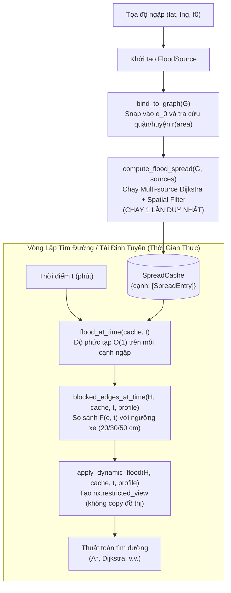

# Gói Mô Phỏng & Định Tuyến Ngập Động (`flood_routing`)

Thư mục `flood_routing` là module chuyên trách mô phỏng, tính toán và định tuyến giao thông dưới ảnh hưởng của hiện tượng ngập lụt động theo không gian và thời gian thực trên mạng lưới giao thông đường bộ Hà Nội. Module được xây dựng để hoạt động tương thích hoàn toàn với nền tảng đồ thị [hanoi-graph](../README.md).

> **Requirements:** Đã cài đặt `hanoi-graph` trước đó.

---

## 1. Mục Đích Của Thư Mục

Trong bài toán tìm đường thực tế tại đô thị Hà Nội vào mùa mưa bão:
1. **Ngập lụt không cố định:** Mực nước biến đổi liên tục theo thời gian $t$ (nước rút dần nhờ hệ thống thoát nước).
2. **Lan tỏa theo mạng lưới giao thông:** Nước từ tâm ngập lan ra các tuyến phố lân cận theo độ dài đường đi thực tế trên đồ thị, độ sâu giảm dần từ tâm ra rìa.
3. **Phụ thuộc vào địa bàn hành chính:** Tốc độ tiêu thoát nước $r(\text{area})$ tại các quận/huyện là khác nhau (ví dụ: các quận nội thành cũ như Đống Đa, Hoàn Kiếm thoát chậm hơn các khu đô thị mới như Nam Từ Liêm, Cầu Giấy).
4. **Phân hóa theo phương tiện:** Cùng một đoạn đường ngập $30\text{ cm}$, xe máy sẽ bị chặn hoàn toàn, ô tô điện cỡ nhỏ (VinFast VF3) đạt ngưỡng giới hạn, trong khi ô tô xăng/dầu (`car_ice`, ngưỡng $50\text{ cm}$) vẫn có thể lưu thông an toàn.
5. **Yêu cầu hiệu năng cao ($O(1)$ dynamic re-planning):** Thuật toán tìm đường động (Dynamic A* / Time-dependent routing) cần kiểm tra trạng thái đường hàng ngàn lần ở các mốc thời gian khác nhau. `flood_routing` tách biệt giai đoạn tính toán trước (pre-compute) và truy vấn thời gian thực để đạt tốc độ hàng ngàn lượt kiểm tra mỗi giây.

---

## 2. Mô Hình Toán Học & Vật Lý Cốt Lõi

Module hiện thực hóa 5 công thức vật lý chuẩn hóa:

### 2.1. Bán kính ảnh hưởng theo độ sâu ngập tâm
Bán kính lan tỏa $R$ (mét) của vùng ngập tỷ lệ thuận với căn bậc hai của độ sâu ngập ban đầu tại tâm $F_0$ (cm):
$$R = k \times \sqrt{F_0}$$
*Trong đó:* $k = 50.0$ (hằng số điều chỉnh lan tỏa). Ví dụ: với $F_0 = 36\text{ cm}$, bán kính ảnh hưởng là $R = 50 \times \sqrt{36} = 300\text{ m}$.

### 2.2. Suy giảm tuyến tính theo khoảng cách mạng lưới
Độ sâu ngập $F(e)$ tại cạnh $e$ cách tâm ngập một khoảng đường bộ $\text{dist}(e)$ được tính theo công thức suy giảm tuyến tính:
$$F(e) = F_0 \times \max\left(0, 1 - \frac{\text{dist}(e)}{R}\right) = F_0 \times \alpha_0(e)$$
*Trong đó:* Hệ số $\alpha_0(e) \in [0, 1]$ được tính trước (pre-compute) thông qua thuật toán Multi-source Dijkstra trên mạng lưới đường bộ thực.

### 2.3. Rút nước theo thời gian và quận/huyện
Tại thời điểm $t$ (tính bằng phút kể từ khi quan trắc), độ sâu ngập tại tâm giảm đều theo tốc độ tiêu thoát nước của quận/huyện tương ứng:
$$F_0(e_0, t) = \max\left(0, F_0 - r(\text{area}) \times t\right)$$
*Trong đó:* $r(\text{area})$ là tốc độ rút nước định mức của quận/huyện (đơn vị: $\text{cm/phút}$).

### 2.4. Xử lý chồng lấn nhiều điểm ngập
Khi một đoạn đường chịu ảnh hưởng đồng thời từ nhiều điểm ngập khác nhau, độ sâu ngập thực tế được xác định bằng giá trị ngập lớn nhất, **tuyệt đối không cộng dồn** (tránh sai lệch vật lý):
$$F(e, t) = \max_{s \in \text{Sources}} \left( F_0^{(s)}(t) \times \alpha^{(s)}(e) \right)$$

### 2.5. Lọc cạnh theo khả năng lội nước của phương tiện
Một cạnh $e$ bị coi là **bị chặn (blocked)** đối với phương tiện nếu độ sâu ngập vượt quá giới hạn lội nước an toàn:
$$\text{Blocked}(e, t) \iff F(e, t) > W_{\text{vehicle}}$$
- Xe máy xăng thông thường (`motorbike_ice`): $W = 20\text{ cm}$
- Ô tô điện mini (`vf3`): $W = 30\text{ cm}$
- Ô tô xăng/dầu (`car_ice`): $W = 50\text{ cm}$

---

## 3. Cấu Trúc Thư Mục & Vai Trò Các Tệp Tin

```
flood_routing/
│
├── __init__.py           # Khai báo public API cho toàn package
├── flood_config.py       # Tham số, hằng số cấu hình & bảng tốc độ rút nước 30 quận/huyện
├── flood_models.py       # Định nghĩa lớp đối tượng FloodSource & snap tọa độ ngập
└── flood_engine.py       # Động cơ Multi-source Dijkstra, tính ngập động & restricted view
```

### Chi tiết nhiệm vụ từng tệp:

| Tệp tin | Nhiệm vụ chính | Các hàm / Lớp trọng tâm |
| :--- | :--- | :--- |
| [flood_config.py](flood_config.py) | - Định nghĩa kiểu `EdgeKey` hỗ trợ cả `DiGraph` và `MultiDiGraph`.<br>- Bảng tốc độ tiêu thoát nước cơ sở cho 30 đơn vị hành chính Hà Nội.<br>- Hàm chuẩn hóa tên quận/huyện không phân biệt chữ hoa/thường hoặc dấu. | `DRAINAGE_RATES`<br>`get_drain_rate_for_district()`<br>`RADIUS_K` ($50.0$)<br>`DEFAULT_DRAIN_RATE` ($0.5\text{ cm/phút}$) |
| [flood_models.py](flood_models.py) | - Đối tượng hóa điểm ngập động `FloodSource`.<br>- Chiếu điểm ngập vào cạnh gần nhất kèm khoảng cách offset tới 2 đầu nút $u_0, v_0$.<br>- Tính toán bán kính động và độ sâu theo thời gian $t$. | `FloodSource`<br>`snap_coord_to_edge_with_offset()`<br>`snap_coord_to_edge()`<br>`FloodSource.f0_at_time()`<br>`FloodSource.radius_at_time()` |
| [flood_engine.py](flood_engine.py) | - Động cơ thuật toán Multi-source Dijkstra lan tỏa vùng ngập.<br>- Lọc không gian kết hợp R-tree/Spatial Index (`idx.within`).<br>- Tính độ sâu ngập tại thời điểm $t$ với chi phí $O(1)$ mỗi cạnh.<br>- Tạo đồ thị view giới hạn (`nx.restricted_view`) loại trừ đường ngập. | `compute_flood_spread()`<br>`flood_at_time()`<br>`blocked_edges_at_time()`<br>`apply_dynamic_flood()`<br>`SpreadCache`, `SpreadEntry` |
| [__init__.py](__init__.py) | - Xuất đầy đủ các hàm và lớp chuẩn ra bên ngoài giúp import thuận tiện:<br>`from flood_routing import FloodSource, compute_flood_spread, ...` | `__all__` |

---

## 4. Danh Sách Tên & Công Dụng Của Các Hàm Quan Trọng (API Reference)

Dưới đây là bảng tra cứu nhanh và chi tiết đặc tả từng hàm, lớp quan trọng cốt lõi trong gói `flood_routing`:

### 4.1. Bảng tra cứu nhanh các hàm & lớp

| Tên Hàm / Lớp | Tệp mã nguồn | Công dụng chính |
| :--- | :--- | :--- |
| [`compute_flood_spread()`](flood_engine.py) | `flood_engine.py` | Chạy Multi-source Dijkstra + R-tree tiền tính toán vùng lan tỏa ngập trên toàn mạng lưới (chạy 1 lần duy nhất). |
| [`flood_at_time()`](flood_engine.py) | `flood_engine.py` | Tính độ sâu ngập $F(e, t)$ của mọi cạnh tại phút thứ $t$ với chi phí $O(1)$ mỗi cạnh, xử lý chồng lấn bằng $\max()$. |
| [`blocked_edges_at_time()`](flood_engine.py) | `flood_engine.py` | Lọc ra danh sách các cạnh bị chặn tại thời điểm $t$ tương ứng với khả năng lội nước của từng loại xe. |
| [`apply_dynamic_flood()`](flood_engine.py) | `flood_engine.py` | Tạo đồ thị an toàn dạng `nx.restricted_view` (zero-copy) đã loại bỏ đường ngập tại thời điểm $t$ để đưa vào tìm đường. |
| [`SpreadEntry`](flood_engine.py) | `flood_engine.py` | Đối tượng lưu trữ nhẹ (`__slots__`) chứa kết quả suy giảm $\alpha_0$ của một nguồn ngập trên một cạnh đường. |
| [`FloodSource`](flood_models.py) | `flood_models.py` | Lớp mô hình hóa điểm ngập động: quản lý tọa độ, độ sâu ban đầu $F_0$, bán kính $R$, quận/huyện và quy luật rút nước. |
| [`snap_coord_to_edge_with_offset()`](flood_models.py) | `flood_models.py` | Chiếu tọa độ điểm ngập vào cạnh gần nhất, tính chính xác khoảng cách offset tới 2 đầu nút $u_0, v_0$. |
| [`snap_coord_to_edge()`](flood_models.py) | `flood_models.py` | Phiên bản rút gọn của phép chiếu tọa độ, trả về khóa định danh `EdgeKey` của cạnh gần nhất. |
| [`get_drain_rate_for_district()`](flood_config.py) | `flood_config.py` | Tra cứu tốc độ rút nước $r(\text{area})$ theo tên quận/huyện (hỗ trợ tiếng Việt có dấu, không dấu, chữ hoa/thường). |

---

### 4.2. Chi tiết công dụng từng hàm & lớp

#### A. Nhóm Động cơ Tính Toán Ngập Động ([flood_engine.py](flood_engine.py))

1. **`compute_flood_spread(G, sources, R=None, get_district_fn=default_get_district, weight="length", use_endpoint_offset=True) -> SpreadCache`**
   - **Mục đích:** Là trái tim của cơ chế tối ưu hiệu năng. Hàm tính toán trước độ lan tỏa ngập từ tất cả các tâm ngập ra mạng lưới giao thông đường bộ xung quanh.
   - **Nguyên lý hoạt động:**
     - Sử dụng thuật toán **Multi-source Dijkstra** với điểm khởi phát là 2 nút đầu mút $u_0, v_0$ của cạnh ngập kèm khoảng cách offset thực tế dọc theo cạnh.
     - Giới hạn phạm vi duyệt bằng bán kính ảnh hưởng $R = k \times \sqrt{F_0}$.
     - Kết hợp lọc không gian sơ bộ thông qua chỉ mục R-tree (`idx.within(lat, lng, R)`) để loại trừ các cạnh nằm ngoài bán kính địa lý.
     - Tính trước hệ số suy giảm tuyến tính $\alpha_0(e) = \max\left(0, 1 - \frac{\text{dist}(e)}{R}\right)$ và lưu vào bộ nhớ đệm `SpreadCache`.
   - **Tần suất gọi:** **Chạy duy nhất 1 lần** khi thiết lập danh sách điểm ngập. Kết quả được tái sử dụng vĩnh viễn cho hàng ngàn lần tìm đường sau đó.

2. **`flood_at_time(spread_cache, t, shrink_radius=False) -> dict[EdgeKey, float]`**
   - **Mục đích:** Xác định độ sâu ngập thực tế $F(e, t)$ của từng đoạn đường tại mốc thời gian $t$ (phút kể từ lúc quan trắc).
   - **Nguyên lý hoạt động:**
     - Với mỗi cạnh trong `spread_cache`, cập nhật độ sâu ngập tại tâm $F_0(t) = \max(0, F_0 - r \times t)$.
     - Nhân với hệ số suy giảm $\alpha_0(e)$ đã tính sẵn để đạt độ phức tạp $O(1)$ trên mỗi cạnh.
     - Khi một cạnh chịu ảnh hưởng từ nhiều nguồn ngập đồng thời, hàm áp dụng phép toán $\max()$ giữa các nguồn, **không cộng dồn** (tuân thủ nguyên lý vật lý cân bằng thủy lực).
   - **Đầu ra:** Dictionary ánh xạ `{edge_key: depth_cm}` với các cạnh có mực nước $> 0\text{ cm}$.

3. **`blocked_edges_at_time(H, spread_cache, t, profile, shrink_radius=False) -> set[EdgeKey]`**
   - **Mục đích:** Sàng lọc và trả về tập hợp tất cả các cạnh trên đồ thị phương tiện $H$ bị cấm lưu thông tại thời điểm $t$.
   - **Nguyên lý hoạt động:**
     - Lấy bản đồ ngập từ `flood_at_time(spread_cache, t)`.
     - So sánh độ sâu $F(e, t)$ với ngưỡng lội nước của phương tiện được cung cấp qua `profile` (chấp nhận tên định danh chuỗi `"motorbike_ice"`, `"vf3"`, `"car_ice"`, đối tượng `VehicleProfile`, hoặc số thực `float` chỉ định mức ngập tối đa tính bằng cm).
     - Khớp chính xác định dạng khóa cạnh của đồ thị $H$ (hỗ trợ cả `DiGraph` và `MultiDiGraph`).

4. **`apply_dynamic_flood(H, spread_cache_or_sources, t, profile, shrink_radius=False, as_view=True) -> nx.Graph`**
   - **Mục đích:** Trực tiếp tạo ra một đồ thị giao thông an toàn tại thời điểm $t$ để đưa vào các thuật toán tìm đường (A*, Dijkstra, v.v.).
   - **Ưu điểm vượt trội:**
     - Mặc định sử dụng cơ chế `nx.restricted_view(H, [], blocked_edges)`. Đây là một **View chỉ đọc (Zero-copy)**, không nhân bản (copy) đồ thị gốc quy mô lớn của Hà Nội, giúp tiết kiệm bộ nhớ RAM và thời gian thực thi chỉ mất **$\sim 0.38\text{ ms}$** cho mỗi lần gọi.
     - Cho phép truyền trực tiếp danh sách `[FloodSource]` (hàm sẽ tự động gọi `compute_flood_spread` nếu chưa có cache sẵn).

5. **`SpreadEntry` & `SpreadCache`**
   - **`SpreadEntry`:** Lớp dữ liệu tối ưu hóa bộ nhớ thông qua `__slots__ = ("source", "dist_e", "base_r", "alpha_0")`, lưu trữ độ suy giảm của một nguồn ngập lên một cạnh cụ thể. Hỗ trợ tuple-unpacking (`for src, alpha in influences:`).
   - **`SpreadCache`:** Bí danh kiểu `dict[EdgeKey, list[SpreadEntry]]` biểu diễn cấu trúc dữ liệu vùng ngập toàn mạng lưới.

---

#### B. Nhóm Mô Hình Hóa Nguồn Ngập & Chiếu Tọa Độ ([flood_models.py](flood_models.py))

6. **Lớp `FloodSource(lat, lng, f0, k=50.0, id="")`**
   - **Mục đích:** Đối tượng hóa một điểm ngập thực địa với đầy đủ các thuộc tính không gian và biến thiên thời gian.
   - **Các phương thức quan trọng:**
     - **`bind_to_graph(G, get_district_fn=default_get_district)`:** Tự động chiếu tọa độ $(lat, lng)$ vào cạnh gần nhất $e_0 = (u_0, v_0)$ của đồ thị $G$, tính khoảng cách từ điểm ngập tới $u_0$ và $v_0$, đồng thời tra cứu tên quận/huyện và gán tốc độ rút nước $r(\text{area})$ chuẩn xác.
     - **`f0_at_time(t) -> float`:** Tính độ sâu ngập tại tâm ở phút thứ $t$: $F_0(t) = \max(0, F_0 - r \times t)$.
     - **`radius_at_time(t, override_r=None, shrink=False) -> float`:** Tính bán kính ngập tại phút thứ $t$. Khi bật `shrink=True`, bán kính co dần theo tỷ lệ căn bậc hai độ sâu nước còn lại.
     - **`radius_at_depth(depth_cm) -> float`:** Tính bán kính lan tỏa $R = k \times \sqrt{F_0}$.

7. **`snap_coord_to_edge_with_offset(G, lat, lng) -> tuple[EdgeKey, float, float]`**
   - **Mục đích:** Chiếu một cặp tọa độ GPS bất kỳ vào cạnh đường bộ gần nhất trên đồ thị $G$ thông qua thuật toán chiếu không gian (`hanoi_graph.snap.snap_point`).
   - **Giá trị trả về:** Tuple gồm 3 phần tử: `(edge_key, dist_to_u_meters, dist_to_v_meters)` đại diện cho khóa của cạnh gần nhất và khoảng cách chính xác từ điểm chiếu đến 2 đầu mút $u, v$ của cạnh đó.

8. **`snap_coord_to_edge(G, lat, lng) -> EdgeKey`**
   - **Mục đích:** Hàm tiện ích rút gọn, nhận tọa độ $(lat, lng)$ và trả về duy nhất khóa định danh `EdgeKey` của cạnh gần nhất trên đồ thị.

---

#### C. Nhóm Cấu Hình & Bảng Tốc Độ Tiêu Thoát Nước ([flood_config.py](flood_config.py))

9. **`get_drain_rate_for_district(district_name: str | None) -> float`**
   - **Mục đích:** Tra cứu tốc độ rút nước định mức $r$ (cm/phút) của khu vực hành chính.
   - **Khả năng tương thích cao:** Sử dụng cơ chế chuẩn hóa slug (`slugify`), tự động nhận diện chính xác dù tên quận/huyện được truyền vào dưới dạng tiếng Việt có dấu (`"Hoàn Kiếm"`), không dấu (`"Hoan Kiem"`), dính liền (`"HoanKiem"`), hay chữ thường (`"hoan kiem"`). Nếu không tìm thấy, hàm tự động trả về giá trị mặc định `DEFAULT_DRAIN_RATE` ($0.50\text{ cm/phút}$).

10. **Các hằng số cấu hình cốt lõi:**
    - `DEFAULT_DRAIN_RATE = 0.50`: Tốc độ tiêu thoát nước ngầm định áp dụng khi không xác định được quận/huyện ($0.50\text{ cm/phút}$).
    - `RADIUS_K = 50.0`: Hệ số tỷ lệ thực nghiệm giữa độ sâu tâm và bán kính lan tỏa mạng lưới.
    - `DRAINAGE_RATES`: Từ điển tra cứu tốc độ rút nước của toàn bộ 30 quận, huyện và thị xã thuộc thành phố Hà Nội.
    - `EdgeKey`: Kiểu chú thích biểu diễn cạnh cho cả đồ thị đơn `(u, v)` và đồ thị đa cạnh `(u, v, key)`.

---

## 5. Luồng Xử Lý (Workflow Pipeline)

Quy trình phối hợp giữa các thành phần trong `flood_routing` được tổ chức như sau:



---

## 6. Hướng Dẫn Sử Dụng Nhanh (Quickstart)

```python
import networkx as nx
from hanoi_graph import load_graph, get_profile, get_vehicle_graph
from flood_routing import (
    FloodSource,
    compute_flood_spread,
    flood_at_time,
    apply_dynamic_flood,
)

# 1. Nạp đồ thị nền Hà Nội
G = load_graph()

# 2. Khai báo danh sách các điểm ngập thực tế
sources = [
    # Ngập 40cm tại Tháp Rùa (Hoàn Kiếm) -> Tự động tính R = 50 * sqrt(40) ≈ 316.2m
    FloodSource(lat=21.02877, lng=105.85236, f0=40.0, id="thap_rua"),
    # Ngập 35cm tại Bến xe Mỹ Đình (Nam Từ Liêm)
    FloodSource(lat=21.02821, lng=105.77839, f0=35.0, id="my_dinh"),
]

# 3. Tính toán trước lan tỏa vùng ngập trên mạng lưới (chỉ chạy 1 lần)
spread_cache = compute_flood_spread(G, sources)

# 4. Tra cứu độ sâu ngập tại thời điểm t = 15 phút sau mưa
flood_map_t15 = flood_at_time(spread_cache, t=15.0)

# 5. Áp dụng ngập động lên đồ thị xe máy (ngưỡng 20cm) tại t = 20 phút
profile_bike = get_profile("motorbike_ice")
H_bike = get_vehicle_graph(G, profile_bike)

# Tạo Restricted Graph View cực nhanh (chỉ mất ~0.3ms, không tốn RAM copy)
# Lưu ý: blocked_edges_at_time tự động chặn cả 2 chiều u <-> v trên H_bike,
# bảo đảm an toàn tuyệt đối cho xe máy đi ngược chiều trên phố một chiều (oneway:motorcycle=no)
H_bike_safe = apply_dynamic_flood(H_bike, spread_cache, t=20.0, profile=profile_bike)

# Đưa H_bike_safe vào A* tìm đường như bình thường!
```

---

## 7. Bảng Tốc Độ Rút Nước Định Mức (30 Đơn Vị Hành Chính Hà Nội)

Tốc độ rút nước $r(\text{area})$ được thiết lập dựa trên đặc tính hạ tầng thoát nước của từng khu vực:

| Khu vực hành chính | Tốc độ $r$ (cm/phút) | Thời gian rút hết 30 cm ngập |
| :--- | :---: | :---: |
| **Nam Từ Liêm, Cầu Giấy, Long Biên** (Đô thị mới, trạm bơm hiện đại) | $0.80 - 0.90$ | $33 - 37$ phút |
| **Ba Đình, Tây Hồ, Hoàng Mai, Hà Đông, Đông Anh, Gia Lâm, Sóc Sơn** | $0.60 - 0.75$ | $40 - 50$ phút |
| **Hoàn Kiếm, Hai Bà Trưng, Thanh Xuân, Đống Đa** (Nội đô lịch sử, trũng thấp) | $0.40 - 0.50$ | $60 - 75$ phút |
| **Các huyện ngoại thành** (Thanh Trì, Hoài Đức, Đan Phượng, Chương Mỹ, v.v.) | $0.50 - 0.65$ | $46 - 60$ phút |
| **Mặc định (Default)** | **0.50** | **60 phút** |

---

## 8. Giải Thích Bộ Kiểm Thử Thực Tế: `tests/test_flood_new.py`

Tệp kiểm thử [tests/test_flood_new.py](../tests/test_flood_new.py) được xây dựng để kiểm chứng toàn diện chức năng, độ chính xác toán học và hiệu năng vận hành của gói `flood_routing` trên **đồ thị Hà Nội thật quy mô lớn** ($256.974$ nodes, $622.345$ edges).

Tệp kiểm thử tập trung độc lập vào cơ chế mô phỏng ngập, không phụ thuộc vào 2 hàm tìm đường, bao gồm 6 bài test chuẩn hóa:

### 8.1. Chi tiết 6 bài kiểm thử (Test Cases)

#### 1. `test_1_landmarks_district_and_dynamic_radius`
- **Mục tiêu:** Kiểm tra khả năng snap điểm ngập vào đúng cạnh đường phố $e_0$, tự động nhận dạng quận/huyện qua tọa độ địa lý, gán đúng tốc độ thoát nước $r(\text{area})$ và tính chính xác bán kính động $R = k \times \sqrt{F_0}$.
- **Dữ liệu kiểm tra:** Thực hiện trên 10 địa danh lớn thuộc các quận khác nhau khắp Hà Nội (Hồ Gươm, Lăng Bác, Bến xe Mỹ Đình, Keangnam, Sân bay Nội Bài, Aeon Mall Long Biên, Văn Miếu, Hồ Tây, ĐH Bách Khoa, Cầu Giấy).
- **Kết quả xác nhận:** $10/10$ landmarks nhận diện chính xác quận hành chính và gắn kết cạnh hợp lệ trên đồ thị có hướng với thời gian dưới $5\text{ ms}$ mỗi điểm.

#### 2. `test_2_single_source_spatial_spread`
- **Mục tiêu:** Kiểm tra độ chính xác của cơ chế lan tỏa theo mạng lưới từ một điểm ngập tâm (tại Tháp Rùa, $F_0 = 40\text{ cm}, R \approx 316.2\text{ m}$).
- **Kết quả xác nhận:** 
  - Điểm ngập lan tỏa chính xác ra mạng lưới các tuyến phố xung quanh.
  - Cạnh nguồn $e_0$ đạt đúng độ sâu ngập $40\text{ cm}$.
  - Trên toàn bộ các cạnh bị ảnh hưởng, độ sâu thỏa mãn $F(e) = F_0 \times (1 - \text{dist}/R)$, giảm dần đều theo khoảng cách mạng lưới từ tâm ra rìa.

#### 3. `test_3_water_recession_over_time`
- **Mục tiêu:** Kiểm chứng quy luật rút nước theo thời gian thực tại các quận có tốc độ thoát nước khác biệt: Hoàn Kiếm ($r = 0.50\text{ cm/phút}$) và Nam Từ Liêm ($r = 0.90\text{ cm/phút}$).
- **Quy trình thử nghiệm:** Khảo sát độ sâu tại các mốc thời gian $t = [0, 10, 20, 40, 55, 72, 85]$ phút.
- **Kết quả xác nhận:** 
  - Tại $t = 40$ phút: Vùng ngập tại Nam Từ Liêm đã rút cạn hoàn toàn về $0\text{ cm}$, trong khi Hoàn Kiếm vẫn còn ngập $16.0\text{ cm}$.
  - Tại $t = 72$ phút: Hoàn Kiếm rút cạn hoàn toàn về $0\text{ cm}$, đồ thị khôi phục trạng thái bình thường.

#### 4. `test_4_overlapping_sources_and_vehicle_thresholds`
- **Mục tiêu:** 
  - **Phần A (Chồng lấn):** Đặt 2 nguồn ngập giao thoa tại Tháp Rùa ($35\text{ cm}$) và Nhà hát Lớn ($48\text{ cm}$) với bán kính $R = 1200\text{ m}$. Đảm bảo các cạnh giao thoa lấy giá trị $\max()$, không bị cộng dồn phi lý.
  - **Phần B (Phân loại phương tiện):** Kiểm tra đối chiếu với các kịch bản chuẩn trong `test_cases.json`:
    - `case_4_flood_on_route` ($35\text{ cm}$): Xe máy (`motorbike_ice`, $20\text{ cm}$) và VF3 (`vf3`, $30\text{ cm}$) bị chặn; Ô tô xăng/dầu (`car_ice`, $50\text{ cm}$) đi qua an toàn.
    - `case_4b_flood_boundary_30cm` ($30\text{ cm}$): Xe máy bị chặn; VF3 và Ô tô con lưu thông bình thường.

#### 5. `test_5_flood_routing_performance_on_real_map` (Benchmark)
- **Mục tiêu:** Đo lường hiệu năng xử lý với **10 nguồn ngập đồng thời** trên toàn thành phố Hà Nội.
- **Kết quả đo lường thực tế:**

| Hạng mục hiệu năng | Số lần gọi | Tổng thời gian | Thời gian TB / lần gọi | Tốc độ xử lý |
| :--- | :---: | :---: | :---: | :---: |
| **`compute_flood_spread`** (10 nguồn đồng thời) | 1 lần | ~4,144 ms | 4.14 giây | Chạy 1 lần duy nhất lúc nạp điểm ngập |
| **`flood_at_time`** (Bán kính cố định $R$) | 1,000 lần | ~171 ms | **171 µs** | **~5,850 truy vấn / giây** |
| **`flood_at_time`** (Co bán kính $R(t)$) | 1,000 lần | ~371 ms | **371 µs** | **~2,700 truy vấn / giây** |
| **`apply_dynamic_flood`** (Tạo restricted view) | 300 lần | ~115 ms | **385 µs** | **~2,600 views / giây** |

> **Ý nghĩa:** Thời gian kiểm tra ngập động chỉ mất từ **0.17 đến 0.38 mili-giây** mỗi lần gọi. Điều này đảm bảo thuật toán tìm đường (A\*, Dynamic Routing) có thể tái định tuyến (re-plan) liên tục trong thời gian thực mà không gây trễ hệ thống.

#### 6. `test_6_motorcycle_contraflow_blocked_on_flooded_oneway_street`
- **Mục tiêu:** Kiểm tra xử lý cạnh ngược chiều (contraflow) của xe máy tại phố một chiều (`oneway:motorcycle=no`) khi có ngập lụt.
- **Dữ liệu kiểm tra:** Đặt điểm ngập $40\text{ cm}$ tại phố Hàng Bông (Hoàn Kiếm). Đồ thị $G$ chỉ có cạnh một chiều, nhưng đồ thị xe máy $H_{\text{moto}}$ có thêm 6 cạnh ngược chiều.
- **Kết quả xác nhận:**
  - $5/6$ cạnh ngược chiều có độ sâu ngập $> 20\text{ cm}$ (đoạn ngập sâu) bị chặn thành công $100\%$ trong `blocked_edges_at_time` và biến mất khỏi restricted view `H_moto_safe`.
  - Xe máy không thể đi ngược chiều vào vùng ngập nguy hiểm.
  - Ô tô xăng/dầu (`car_ice`, $50\text{ cm}$) không bị chặn nhầm vì $40\text{ cm} \le 50\text{ cm}$.

### 8.2. Hướng dẫn chạy bộ kiểm thử

Để chạy kiểm thử kèm bảng kết quả chi tiết hiển thị trực tiếp ra màn hình:

```bash
# Chạy toàn bộ 6 bài test trên bản đồ thật Hà Nội
python -m pytest tests/test_flood_new.py -v -s -rs

# Hoặc chỉ chạy riêng bài benchmark hiệu năng
python -m pytest tests/test_flood_new.py -k "test_5" -v -s
```
